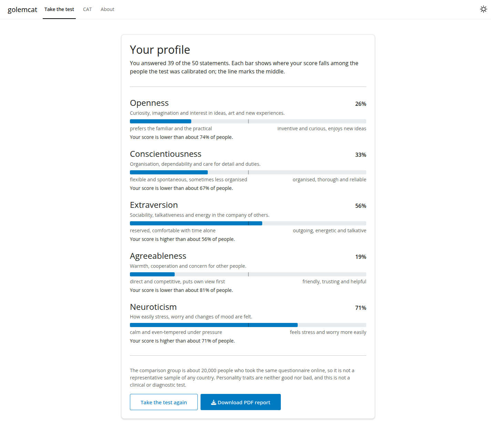
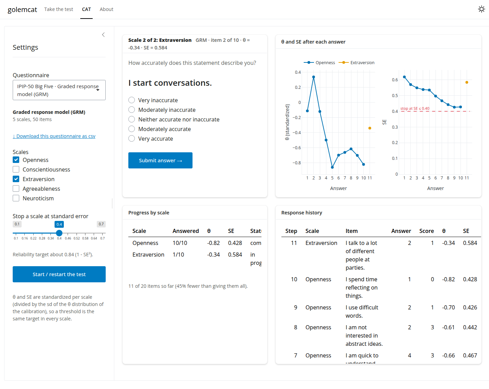
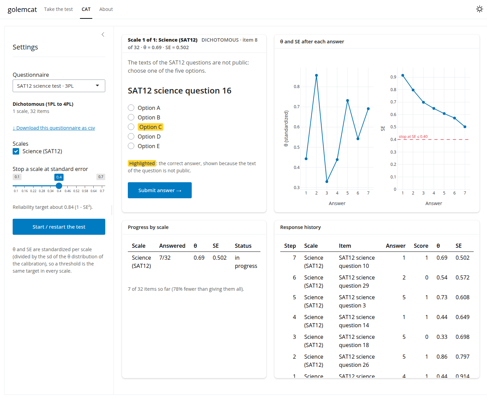

# golemcat: an adaptive Big Five personality test

**golemcat** is an R package with a [Shiny](https://shiny.posit.co/) app, built with
[golem](https://thinkr-open.github.io/golem/), that gives the 50 statements of the IPIP
Big-Five Factor Markers as a **computerized adaptive test (CAT)**. Rather than giving everyone
the same 50 statements, it picks after every answer the statement that tells the most about
the person, and moves on from a trait as soon as its score is precise enough.

## Features

The app has three tabs:

- **Take the test**: the questionnaire as a respondent sees it. One statement at a time with a
  progress bar, and at the end a profile of the five traits, each as a percentile of the
  calibration sample, with what a high and a low score mean.
- **CAT**: an adaptive test with its workings in view, for **any questionnaire and six IRT
  models**. Choose an example or upload your own csv, the scales and the standard error at
  which each stops, then follow after every answer the estimate (θ) and standard error of each
  scale, how many items it used, every answer given, and a plot of θ and SE step by step.
- **About**: how it works, the acknowledgments and the references.

### How it works

- Each trait is scored with the **rating scale model** (Andrich, 1978), with coefficients fitted
  with `mirt` to the answers of 19,718 people.
- After every answer the score is estimated by **EAP** (expected a posteriori), with the normal
  prior that `mirt` estimated for the trait, over a grid of ±6 prior standard deviations.
- The next statement is the one with the most **Fisher information** at that estimate.
- A trait stops when its **standardized standard error** (SE divided by the prior sd) reaches the
  threshold, or when its 10 statements run out. A threshold `se` aims at a reliability of about
  1 − se²: the default 0.40 is about .84 and uses about 43 of the 50 statements.

The engine gives the same results as [catR](https://cran.r-project.org/package=catR), which the
tests check.

## Screenshots

The profile at the end of the test, with the PDF report:



The CAT tab with the graded response model on two of the Big Five traits:



The CAT tab with the SAT12 science test, scored right/wrong with the 3PL. The question texts are not public, so the correct option is highlighted:



## Installation

The repository is private, so `install_github()` needs a GitHub token with access to it
(create one at <https://github.com/settings/tokens>, classic, `repo` scope):

```r
install.packages("devtools")
devtools::install_github("sedzinfo/golemcat", auth_token = "ghp_...")
```

## Usage

```r
library(golemcat)
run_app()                    # stops each trait at SE 0.40
run_app(se_threshold = 0.45) # shorter: about 36 of the 50 statements
```

The engine and the session logic are also functions, for scripts and simulations:

```r
library(golemcat)
q <- ipip50()
s <- cat_start(q$bank, scales = "Extraversion", se_threshold = 0.40)
while (s$stage == "testing") {
  cat(cat_item(s)$question, "\n")
  s <- cat_answer(s, 4) # the answer, 1 to 5
}
cat_results(s)
plot_trajectory(s)
```

## Your own questionnaire: one csv, six models

The CAT tab runs any questionnaire given as a csv file, one row per item, under the six models
of the [cat_irt_eap tutorials](https://sedzinfo.github.io/vignettes/cat_irt_eap/):

| Model | mirt `itemtype` | Example in the app |
|---|---|---|
| Dichotomous 1PL to 4PL | `Rasch` (2 categories), `2PL`, `3PL`, `4PL` | SAT12 science test, 3PL |
| Rating scale (RSM) | `rsm` | IPIP-50 Big Five |
| Partial credit (PCM) | `Rasch` (3+ categories) | IPIP-50 Big Five |
| Graded response (GRM) | `graded` | IPIP-50 Big Five |
| Modified graded response (MGRM) | `grsm` | IPIP-50 Big Five |
| Nominal response (NRM) | `nominal` | SAT12 science test, option by option |

The columns are the item text, its answer options and the coefficients **as mirt names them**,
so a csv is written straight from a fitted model:

```r
library(mirt)
fit <- mirt(responses, 1, itemtype = "graded")       # one model per scale
q <- questionnaire_from_mirt(fit, "Anxiety",
  question = c("I worry a lot", "I feel tense", ...),
  options = c("Never", "Sometimes", "Often", "Always")
)
write_questionnaire(q, "anxiety.csv")                # or a list of scales
```

| Column | |
|---|---|
| `scale`, `question`, `itemtype` | required |
| `item`, `stem` | optional id, and an instruction shown above the item |
| `option1`, `option2`, … | the answer options in scoring order (numbered when absent) |
| `key` | right/wrong items given as several options: the correct one |
| `reverse` | `TRUE` for ordered items scored in reverse |
| `public` | `FALSE` when the item text is not public and only a placeholder is shown: the CAT tab then highlights the correct option (`key`) in yellow |
| `a1`, `b1`…, `c`, `d`, `d0`…, `ak0`…, `g`, `u` | the coefficients of `coef(fit, simplify = TRUE)$items` |
| `prior_mean`, `prior_sd` | mean and sd of the latent trait of the scale (0 and 1 when absent) |

`read_questionnaire()` reads and checks a file, naming the row of any problem, and converts the
coefficients to the catR parameters of each engine; `validate_questionnaire_against_mirt()`
compares the result with the fitted model, item by item. The examples are made by
`data-raw/examples.R` in exactly this way. Download one from the app to see a complete file.

The Take the test tab keeps the IPIP-50 with the rating scale model; its item bank is read with
`read_item_bank()` and `read_likert()`.

## Calibration

The coefficients are a `mirt` rating scale model fitted to each trait separately, on the Big
Five data of the Open-Source Psychometrics Project (19,718 people, after removing one with
missing answers). The 18 reverse-keyed items were reversed (6 − answer) before the fit, and the
app reverses the answers to them the same way. The standard deviations of the latent
distributions are 0.69 to 0.99.

Two caveats:

- **Model fit.** The graded response model fits better than the rating scale model (lower AIC
  and BIC on every trait), because the rating scale model gives every item the same slope and
  thresholds. The Take the test tab uses the rating scale model; the CAT tab has the graded
  and the other models as examples.
- **Comparison group.** The percentiles compare with the people who took the test online, not
  with a representative sample of any population. This is a teaching and research tool, not a
  clinical or diagnostic instrument.

Post hoc CAT on 1,000 real respondents (reliability = 1 − mean SE², standardized):

| SE threshold | statements of 50 | reliability per trait |
|---|---|---|
| all statements | 50 | .79–.89 |
| 0.35 | ~48 | .79–.87 |
| 0.40 | ~43 | .79–.84 |
| 0.45 | ~36 | .77–.81 |
| 0.50 | ~29 | .74–.77 |

## Development

| File | Contents |
|---|---|
| `R/run_app.R` | `run_app()`, with the help page that describes every tab |
| `R/app_ui.R`, `R/app_server.R` | The navbar with the three tabs, and the server, which starts the modules |
| `R/mod_test.R`, `R/mod_lab.R`, `R/mod_about.R` | One Shiny module per tab |
| `R/fct_rsm.R` | The rating scale model engine: probabilities, information, item selection, EAP |
| `R/fct_engine_*.R` | The other five engines (4PL, PCM, GRM, MGRM, NRM), ported unchanged from the cat_irt_eap tutorials |
| `R/fct_questionnaire.R` | The csv format of any questionnaire: reading, checking, writing from mirt, the examples |
| `R/fct_item_bank.R` | Reading and checking item banks, and the IPIP-50 |
| `R/fct_cat.R` | The CAT session: start, next item, answer, results |
| `inst/extdata/` | The IPIP-50 item bank and answer options; `examples/`, one questionnaire per model |
| `data-raw/examples.R` | Fits the six example questionnaires with mirt and checks them |
| `tests/testthat/` | Tests of the engines (all six against catR), the csv format, the session, the modules and the page |

Run the tests with `devtools::test()` and the full check with `devtools::check()`.
`generate_package.R` documents, tests and installs the package, and builds the PDF manual and
the tarball.

## Acknowledgments

The statements are the Big-Five Factor Markers of the
[International Personality Item Pool](https://ipip.ori.org/) (Goldberg, 1992), in the public
domain. The calibration data is from the
[Open-Source Psychometrics Project](https://openpsychometrics.org/). The models were fitted with
[mirt](https://cran.r-project.org/package=mirt), and the engine follows
[catR](https://cran.r-project.org/package=catR).

## References

- Andrich, D. (1978). A rating formulation for ordered response categories. *Psychometrika*, 43(4), 561-573.
- Bock, R. D. (1972). Estimating item parameters and latent ability when responses are scored in two or more nominal categories. *Psychometrika*, 37(1), 29-51.
- Chalmers, R. P. (2012). mirt: A multidimensional item response theory package for the R environment. *Journal of Statistical Software*, 48(6), 1-29.
- Goldberg, L. R. (1992). The development of markers for the Big-Five factor structure. *Psychological Assessment*, 4(1), 26-42.
- Magis, D., & Barrada, J. R. (2017). Computerized adaptive testing with R: Recent updates of the package catR. *Journal of Statistical Software*, 76(1), 1-19.
- Masters, G. N. (1982). A Rasch model for partial credit scoring. *Psychometrika*, 47(2), 149-174.
- Muraki, E. (1990). Fitting a polytomous item response model to Likert-type data. *Applied Psychological Measurement*, 14(1), 59-71.
- Samejima, F. (1969). Estimation of latent ability using a response pattern of graded scores. *Psychometrika Monograph Supplement*, 17.
- van der Linden, W. J., & Glas, C. A. W. (Eds.) (2010). *Elements of Adaptive Testing*. Springer.

## License

GPL-3.
