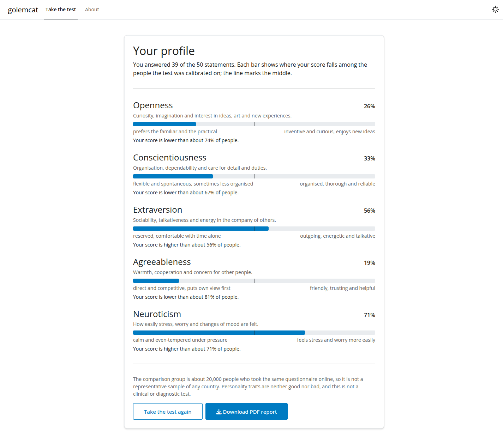

# golemcat: an adaptive Big Five personality test

**[Open the live
app](https://sedzinfo-golemcat.share.connect.posit.cloud/)** · [Help
pages](https://sedzinfo.github.io/golemcat/reference/)

## What it does

**golemcat** is an R package with a [Shiny](https://shiny.posit.co/)
app, built with [golem](https://thinkr-open.github.io/golem/), that
gives the 50 statements of the IPIP Big-Five Factor Markers as a
**computerized adaptive test (CAT)**. Rather than giving everyone the
same 50 statements, it picks after every answer the statement that tells
the most about the person, and moves on from a trait as soon as its
score is precise enough.

## Features

The app has two tabs:

- **Take the test**: the questionnaire as a respondent sees it. One
  statement at a time with a progress bar, and at the end a profile of
  the five traits, each as a percentile of the calibration sample, with
  what a high and a low score mean, and a **PDF report** of it.
- **About**: how it works, the acknowledgments and the references.

To see the workings of the adaptive test, the estimate and its standard
error after every answer, open the **CAT** tab of
[golemirt](https://github.com/sedzinfo/golemirt), which runs it under
the rating scale model and five other IRT models, on any questionnaire
given as a csv file.

### How it works

- Each trait is scored with the **rating scale model** (Andrich, 1978),
  with coefficients fitted with `mirt` to the answers of 19,718 people.
- After every answer the score is estimated by **EAP** (expected a
  posteriori), with the normal prior that `mirt` estimated for the
  trait, over a grid of ±6 prior standard deviations.
- The next statement is the one with the most **Fisher information** at
  that estimate.
- A trait stops when its **standardized standard error** (SE divided by
  the prior sd) reaches the threshold, or when its 10 statements run
  out. A threshold `se` aims at a reliability of about 1 − se²: the
  default 0.40 is about .84 and uses about 43 of the 50 statements.

The engine gives the same results as
[catR](https://cran.r-project.org/package=catR), which the tests check.

## Installation

### 1. Install R

Download R 4.1 or newer from [CRAN](https://cran.r-project.org/), for
Windows, macOS or Linux, and run the installer.

### 2. Install RStudio or Positron

An editor makes R easier to use. It is optional, and both are free, from
Posit:

- [RStudio Desktop](https://posit.co/download/rstudio-desktop/)
- [Positron](https://positron.posit.co/download.html), which also runs
  Python

### 3. Install golemcat

Run one of these in RStudio, Positron or the R console. Each one also
installs the packages golemcat needs.

#### From R-universe (recommended)

[`install.packages`](https://rdrr.io/r/utils/install.packages.html)`(`` `` ``"golemcat"``,`` `` repos ``=`` `[`c`](https://rdrr.io/r/base/c.html)`(``"https://sedzinfo.r-universe.dev"``, ``"https://cloud.r-project.org"``)`` ``)`

[R-universe](https://sedzinfo.r-universe.dev/golemcat) builds golemcat
from this repository after every change, ready to install on Windows,
macOS and Linux, and CRAN provides the packages it needs.

#### From GitHub

[`install.packages`](https://rdrr.io/r/utils/install.packages.html)`(``"pak"``)`` ``# once`` ``pak``::`[`pak`](https://pak.r-lib.org/reference/pak.html)`(``"sedzinfo/golemcat"``)`

#### From the release tarball

The [latest
release](https://github.com/sedzinfo/golemcat/releases/tag/latest) has
the source tarball and the PDF manual, rebuilt from `main` on every
change:

[`install.packages`](https://rdrr.io/r/utils/install.packages.html)`(``"pak"``)`` ``# once`` ``pak``::`[`pak`](https://pak.r-lib.org/reference/pak.html)`(``"url::https://github.com/sedzinfo/golemcat/releases/download/latest/golemcat_0.0.0.9000.tar.gz"``)`

#### From a clone of the repository

This repository keeps no files in [Git LFS](https://git-lfs.com), so a
plain clone with [Git](https://git-scm.com/downloads) has everything:

``` bash
git clone https://github.com/sedzinfo/golemcat.git
```

[`install.packages`](https://rdrr.io/r/utils/install.packages.html)`(``"pak"``)`` ``# once`` ``pak``::`[`local_install`](https://pak.r-lib.org/reference/local_install.html)`(``"path/to/golemcat"``)`

The PDF report of the app needs [typst](https://typst.app) or
[quarto](https://quarto.org) installed.

## Usage

[`library`](https://rdrr.io/r/base/library.html)`(`[`golemcat`](https://sedzinfo.github.io/golemcat/)`)`` `[`run_app`](https://sedzinfo.github.io/golemcat/reference/run_app.md)`(``)`` ``# stops each trait at SE 0.40`` `[`run_app`](https://sedzinfo.github.io/golemcat/reference/run_app.md)`(``se_threshold ``=`` ``0.45``)`` ``# shorter: about 36 of the 50 statements`

The engine and the session logic are also functions, for scripts and
simulations:

[`library`](https://rdrr.io/r/base/library.html)`(`[`golemcat`](https://sedzinfo.github.io/golemcat/)`)`` ``q`` ``<-`` `[`ipip50`](https://sedzinfo.github.io/golemcat/reference/ipip50.md)`(``)`` ``s`` ``<-`` `[`cat_start`](https://sedzinfo.github.io/golemcat/reference/cat_start.md)`(``q``$``bank``, scales ``=`` ``"Extraversion"``, se_threshold ``=`` ``0.40``)`` ``while`` ``(``s``$``stage`` ``==`` ``"testing"``)`` ``{`` `` `[`cat`](https://rdrr.io/r/base/cat.html)`(`[`cat_item`](https://sedzinfo.github.io/golemcat/reference/cat_item.md)`(``s``)``$``question``, ``"\n"``)`` `` ``s`` ``<-`` `[`cat_answer`](https://sedzinfo.github.io/golemcat/reference/cat_answer.md)`(``s``, ``4``)`` ``# the answer, 1 to 5`` ``}`` `[`cat_results`](https://sedzinfo.github.io/golemcat/reference/cat_results.md)`(``s``)`` `[`report_pdf`](https://sedzinfo.github.io/golemcat/reference/report_pdf.md)`(`[`cat_results`](https://sedzinfo.github.io/golemcat/reference/cat_results.md)`(``s``)``, ``"profile.pdf"``, ``q``$``bank``)`` ``# needs typst or quarto`

Any questionnaire fitted with the rating scale model of `mirt`
(`itemtype = "rsm"`) can be read with
[`read_item_bank()`](https://sedzinfo.github.io/golemcat/reference/read_item_bank.md)
and
[`read_likert()`](https://sedzinfo.github.io/golemcat/reference/read_likert.md);
[`validate_item_bank_against_mirt()`](https://sedzinfo.github.io/golemcat/reference/validate_item_bank_against_mirt.md)
checks the bank against the fitted model, item by item.

## Screenshots

The profile at the end of the test, with the PDF report:



Take the test: the profile

## Calibration

The coefficients are a `mirt` rating scale model fitted to each trait
separately, on the Big Five data of the Open-Source Psychometrics
Project (19,718 people, after removing one with missing answers). The 18
reverse-keyed items were reversed (6 − answer) before the fit, and the
app reverses the answers to them the same way. The standard deviations
of the latent distributions are 0.69 to 0.99.

Two caveats:

- **Model fit.** The graded response model fits better than the rating
  scale model (lower AIC and BIC on every trait), because the rating
  scale model gives every item the same slope and thresholds. The app
  supports the rating scale model only; the CAT tab of golemirt has the
  graded and the other models.
- **Comparison group.** The percentiles compare with the people who took
  the test online, not with a representative sample of any population.
  This is a teaching and research tool, not a clinical or diagnostic
  instrument.

Post hoc CAT on 1,000 real respondents (reliability = 1 − mean SE²,
standardized):

| SE threshold   | statements of 50 | reliability per trait |
|----------------|------------------|-----------------------|
| all statements | 50               | .79–.89               |
| 0.35           | ~48              | .79–.87               |
| 0.40           | ~43              | .79–.84               |
| 0.45           | ~36              | .77–.81               |
| 0.50           | ~29              | .74–.77               |

## Development

| File | Contents |
|----|----|
| `R/run_app.R` | [`run_app()`](https://sedzinfo.github.io/golemcat/reference/run_app.md), with the help page that describes every tab |
| `R/app_ui.R`, `R/app_server.R` | The navbar with the two tabs, and the server, which starts the modules |
| `R/mod_test.R`, `R/mod_about.R` | One Shiny module per tab |
| `R/fct_rsm.R` | The rating scale model engine: probabilities, information, item selection, EAP |
| `R/fct_item_bank.R` | Reading and checking item banks, and the IPIP-50 |
| `R/fct_cat.R` | The CAT session: start, next item, answer, results |
| `R/fct_report.R`, `inst/report/` | The PDF report: the typst template and its fonts (Manrope, SIL Open Font License) |
| `inst/extdata/` | The IPIP-50 item bank and answer options |
| `tests/testthat/` | Tests of the engine (against catR), the item bank, the session, the report, the modules and the page |

Run the tests with
[`devtools::test()`](https://devtools.r-lib.org/reference/test.html) and
the full check with
[`devtools::check()`](https://devtools.r-lib.org/reference/check.html).
`generate_package.R` documents, tests and installs the package, and
builds the PDF manual and the tarball.

## Acknowledgments

The statements are the Big-Five Factor Markers of the [International
Personality Item Pool](https://ipip.ori.org/) (Goldberg, 1992), in the
public domain. The calibration data is from the [Open-Source
Psychometrics Project](https://openpsychometrics.org/). The models were
fitted with [mirt](https://cran.r-project.org/package=mirt), and the
engine follows [catR](https://cran.r-project.org/package=catR).

## References

- Andrich, D. (1978). A rating formulation for ordered response
  categories. *Psychometrika*, 43(4), 561-573.
- Chalmers, R. P. (2012). mirt: A multidimensional item response theory
  package for the R environment. *Journal of Statistical Software*,
  48(6), 1-29.
- Goldberg, L. R. (1992). The development of markers for the Big-Five
  factor structure. *Psychological Assessment*, 4(1), 26-42.
- Magis, D., & Barrada, J. R. (2017). Computerized adaptive testing with
  R: Recent updates of the package catR. *Journal of Statistical
  Software*, 76(1), 1-19.
- van der Linden, W. J., & Glas, C. A. W. (Eds.) (2010). *Elements of
  Adaptive Testing*. Springer.

------------------------------------------------------------------------

[](https://sedzinfo.r-universe.dev/golemcat)

